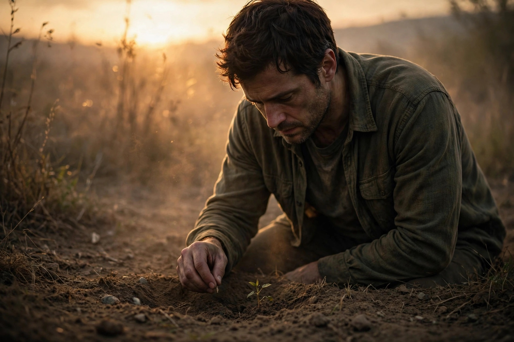

# 03 - The Seed
by Obinna D. Ugoeke, Snr

   

Nobody sees the seed when it is planted. That is why people mock it.

They see you reading. They see you writing. They see you praying. They see you refusing the quick money, refusing the easy road, refusing to become what everybody else has become.

And they laugh. "What are you doing? You are wasting time. You are wasting your life."

They do not know you are planting.

A seed does not look like a tree. It looks like nothing. It looks like dirt. It looks like waste. If you do not know what is inside it, you will step on it.

That is what most people do. They step on other people's beginnings because it does not look impressive yet.

But the seed does not argue. It does not explain itself. It just stays in the dark and does the quiet work. It breaks open. It roots down before it grows up. It understands something people do not understand: growth is first invisible.

Months pass. Years pass. Still nothing to show. People say, "We told you."

Then one morning, something small pushes through the ground. Green. Fragile. Almost easy to miss. But it is alive.

And then it grows. Slowly. Then suddenly. Then it becomes too big to ignore. Then the same people who laughed come to sit under its shade.

They will say, "You are lucky." They will say, "God just blessed you." They will forget the years you were in the dark, watering something nobody could see.

Do not be angry. Let them sit. The tree was never for revenge. It was for proof.

Proof that the dark was not the end. It was the beginning.

So if you are in your seed season now, and nobody sees you, do not dig yourself up to prove you are growing.

Stay. Root down. Grow down first.

Your season to show is coming. And when it comes, you will not need to announce it. The fruit will speak.

© 2026 Obinna D. Ugoeke, Snr. All Rights Reserved.
