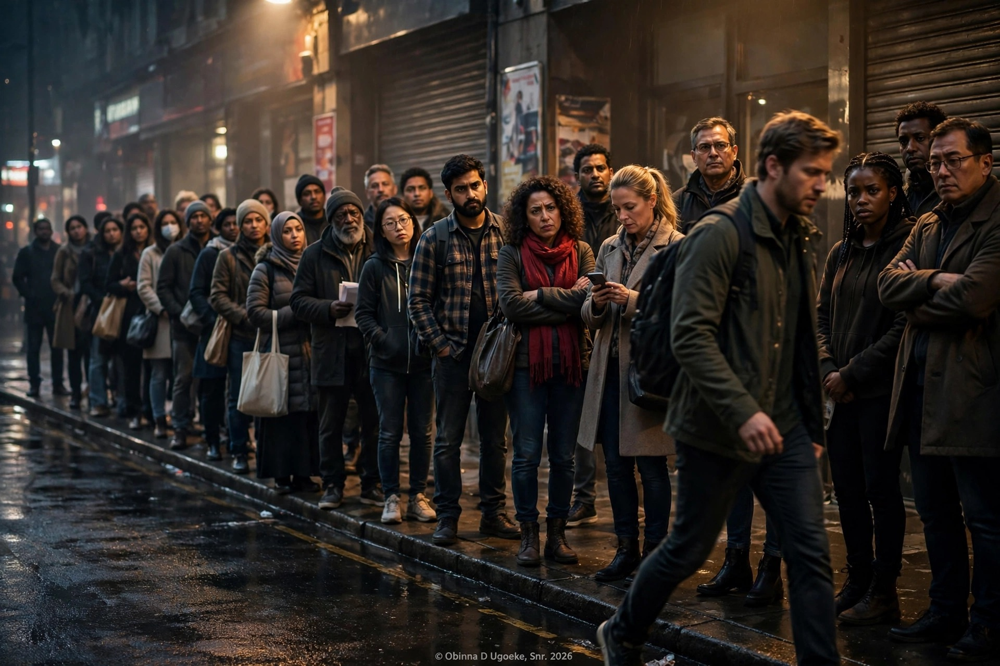

# 04 - The Act Didn't Change
by Obinna D. Ugoeke, Snr

   

He did not change. The act did not change. Only the audience changed.

That is what nobody wants to admit.

When he was poor, he was humble. When he was unknown, he was kind. When he had nothing, he greeted everybody. People said, "That boy has a good heart."

Then he got small money. Small fame. Small power. And suddenly, the same people said, "He has changed. Money has changed him."

But money did not change him. Money only removed the fear of being caught.

When you have nothing, you are forced to be nice. You need people. You need favour. You need doors to open. So you smile. You respect. You apologize quickly.

When you have something, you no longer need to pretend. You can finally show who you were all along.

That is why power is not a test of character. Power is a reveal of character.

The man who was truly humble when he was broke will remain humble when he is rich. The man who was only pretending will drop the act the day he no longer needs you.

So do not be surprised when people change after they rise. Be grateful. You finally saw them without the mask.

And the same is true for you. Do not pray only for blessing. Pray for the character to carry blessing without becoming cruel.

Because the act did not change. The stage just got bigger, and the lights got brighter. And under bright light, everybody's true face shows.

© 2026 Obinna D. Ugoeke, Snr. All Rights Reserved.
